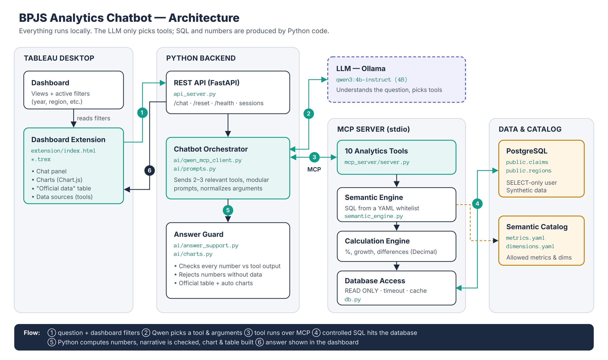

# BPJS Analytics Chatbot

**Ask questions about healthcare service data in plain language, right inside a Tableau dashboard. The answers come from a local LLM, and the numbers in them come from code, not from the model.**


> **Disclaimer:** this is a personal project and is not an official product of BPJS Kesehatan.
> The repository contains no real data. Table and column names are generic, and the sample
> data is generated randomly by [`scripts/generate_sample_data.py`](scripts/generate_sample_data.py).

<!-- Add a demo GIF or screenshot here, e.g.  -->

## Contents

- [At a glance](#at-a-glance)
- [Background](#background)
- [What it does](#what-it-does)
- [Architecture](#architecture)
- [Key concepts](#key-concepts)
- [Design decisions](#design-decisions)
- [Walkthrough: one question, end to end](#walkthrough-one-question-end-to-end)
- [Analytics tools and semantic catalog](#analytics-tools-and-semantic-catalog)
- [Testing and evaluation](#testing-and-evaluation)
- [Getting started](#getting-started)
- [Configuration](#configuration)
- [Adapting it to your own data](#adapting-it-to-your-own-data)
- [Lessons learned](#lessons-learned)
- [Glossary](#glossary)
- [Limitations and roadmap](#limitations-and-roadmap)
- [Project structure](#project-structure)
- [License](#license)

## At a glance

| Aspect | Summary |
|---|---|
| **What** | A chat assistant embedded in a Tableau dashboard that answers analytical questions about healthcare claims data |
| **How** | A local LLM (Qwen3 4B Instruct via Ollama) picks one of 10 analytics tools exposed over the Model Context Protocol (MCP). The tools query PostgreSQL through a whitelisted semantic layer. |
| **Key idea** | The model *chooses*, the code *computes*. The LLM never writes SQL and never does arithmetic, and every number it mentions is checked against the data. |
| **Runs on** | A single laptop with 8 GB of RAM. No cloud API or API key is needed. |
| **Language** | The chatbot works in Indonesian. Code comments and docs are partly Indonesian, and this README is in English. |

## Background

[BPJS Kesehatan](https://www.bpjs-kesehatan.go.id/) is the agency that runs JKN, Indonesia's
national health insurance program. Hospitals submit claims for the services they provide, and
each claim records the billed amount, the amount approved after verification, the diagnosis,
the type of care (outpatient or inpatient), the region, and member attributes such as age group
and membership segment. Analysts monitor this data with dashboards.

The problem is that a dashboard can only answer the questions its views were built for. Any new
question means asking an analyst or writing SQL. A general-purpose chatbot could help, but it can
also invent figures, and for cost data a single wrong digit makes the answer useless.

This project explores a middle path: let a small, local language model understand the question,
but keep every query and every number under the control of ordinary, testable code.

New to the Indonesian terms (RJTL, RITL, DIVRE, PBI, …)? See the [Glossary](#glossary).

## What it does

Users type a question in everyday Indonesian. The active dashboard filters (year, region, and so
on) are sent with it. Every answer contains:

1. a short narrative written by the LLM;
2. an automatic chart, chosen by code according to the shape of the data;
3. an **"official data" table** (*Data resmi*) generated by Python from the query result;
4. the list of tools used, so users can see where the numbers came from.

| Example question (Indonesian) | English | Tool chosen |
|---|---|---|
| *Bagaimana distribusi peserta berdasarkan jenis kelamin?* | How are members distributed by sex? | `metric_share` |
| *Wilayah mana yang memiliki total biaya verifikasi tertinggi?* | Which region has the highest total verified cost? | `analyze_data` |
| *Apakah wilayah dengan jumlah pelayanan tertinggi juga memiliki biaya verifikasi tertinggi?* | Does the region with the most services also have the highest verified cost? | `compare_metrics` |
| *Diagnosis apa yang paling banyak ditemukan pada pelayanan rawat inap?* | What are the most common diagnoses in inpatient care? | `top_categories` |
| *Berapa pertumbuhan total biaya tagihan dari tahun 2022 ke 2023?* | How much did total billed cost grow from 2022 to 2023? | `metric_growth` |
| *Buat ringkasan karakteristik peserta berdasarkan jenis kelamin, umur, dan segmen.* | Summarize member characteristics by sex, age, and segment. | `profile_summary` |

## Architecture



1. The Tableau extension sends the question and the active dashboard filters to a local FastAPI server.
2. The orchestrator sends Qwen3 4B Instruct (running in Ollama) a prompt with only the 2–3 tools relevant to the question. Qwen replies with a tool call and its arguments.
3. The tool runs on an MCP server over stdio.
4. The Semantic Engine builds parameterized SQL from a whitelisted YAML catalog and runs it in a read-only transaction.
5. Python computes the derived figures. Qwen writes the narrative, and the answer guard checks every number in it against the tool output.
6. The answer, chart, and data table are rendered in the dashboard.

A component-by-component description, a sequence diagram, and an explanation of the two-layer
whitelist are in [docs/architecture.md](docs/architecture.md).

## Key concepts

If some of these ideas are new to you, this is the minimum needed to follow the code.

**Tool calling (function calling).** Instead of answering directly, an LLM can reply with a
structured request such as `{"name": "metric_share", "arguments": {...}}`. The application runs
the function and gives the result back to the model, which then writes the final answer. Ollama
supports this for Qwen3.

**Model Context Protocol (MCP).** [MCP](https://modelcontextprotocol.io) is an open standard for
exposing tools and data to LLM applications. Here the 10 analytics tools live in a separate MCP
server process (`mcp_server/server.py`). The chatbot discovers and calls them over stdio. Because
the tools follow the protocol, any MCP-capable client can use them, not only this chatbot.

**Semantic layer.** A catalog that defines business concepts once ("total verified cost" =
`SUM(verified_amount)`, "region" = `service_region_code` joined to `regions`) so that nobody, human
or model, has to write raw SQL. The model speaks in metrics and dimensions, and the semantic
layer translates them into safe SQL. See [`config/metrics.yaml`](config/metrics.yaml) and
[`config/dimensions.yaml`](config/dimensions.yaml).

**Why a small local model?** Claims data is sensitive, so it should not leave the machine. A local
4B model is private and free to run. It is also weaker than large cloud models, which is exactly
why the system around it has to carry the reliability.

## Design decisions

### 1. The LLM never writes SQL
Asking a 4B model to write free-form SQL against a table with 30+ columns is error-prone and
unsafe. Instead, Qwen only chooses a tool and fills in a metric, dimensions, and filters. Each
choice is validated against the YAML catalog and against a second whitelist in code. The SQL is
assembled from whitelisted expressions, values are passed as query parameters, and `sqlglot`
confirms that the result is a single read-only `SELECT`. The model cannot reach a column the
catalog does not expose.

### 2. Numbers are computed, then verified
Aggregations run in PostgreSQL. Percentages, growth rates, differences, and rankings are computed
by a Calculation Engine using `Decimal`. The model only narrates. After it answers:

- every number in the narrative is matched against the tool results, and unmatched numbers trigger a visible warning (or a rewrite, with `ANSWER_NUMBER_MODE=correct`);
- an answer that contains data figures but called no tool is discarded. The model is asked once more to call a tool, and if it still does not, the user is told that no data was retrieved;
- the "official data" table, generated by Python, is appended to every answer, so the source of truth is always on screen.

### 3. Built to run on an 8 GB laptop
A keyword-based router sends only the relevant tools to the model (2–3 of 10 on average). The
system prompt is modular, with core rules always included and tool guides only for the selected
tools, which makes it about 50% shorter. Conversation history is compacted to questions and final
answers, and tool results are sent as compact JSON with numbers already formatted.

### 4. Charts come from data, not from the model
[`ai/charts.py`](ai/charts.py) picks the chart type from the shape of the result: horizontal bars
for one dimension, a line for years or months, 100% stacked bars for within-group shares, grouped
bars for rankings or multiple metrics, and separate charts when units differ (no dual axes). The
model never touches the chart, so the chart always matches the table.

### 5. Secure by default
- Read-only transaction and a per-query statement timeout
- Identity columns (`member_id`, `claim_id`, and others) are blocked as dimensions and used only inside aggregates
- Database errors are logged to `logs/` and never sent to the user
- The API listens on `127.0.0.1` by default, and CORS is off unless `CORS_ORIGINS` is set

### 6. Fast on large tables
`COUNT(DISTINCT …)` is rewritten as `SELECT DISTINCT` + `COUNT(*)`, which gives the same result
but lets PostgreSQL use hash aggregates and parallel workers. Distinct metrics are computed
separately and merged in Python. Query results are cached in memory (10 minutes by default).

## Walkthrough: one question, end to end

The output below is real. It was produced against the synthetic database
(`generate_sample_data.py --rows 30000`, default seed), so your numbers will match if you use the
same settings.

**1. The user asks**

> *Bagaimana distribusi biaya verifikasi berdasarkan jenis pelayanan tahun 2024?*
> ("How is verified cost distributed by type of care in 2024?")

**2. Qwen replies with a tool call** instead of an answer (simplified):

```json
{
  "name": "metric_share",
  "arguments": {
    "metric": "total_biaya_verifikasi",
    "dimensions": ["jenis_pelayanan"],
    "filters": {"tahun_pelayanan": 2024}
  }
}
```

**3. The Semantic Engine turns it into parameterized SQL.** Note that `2024` is a parameter, not
part of the SQL text:

```sql
SELECT t."service_type" AS "jenis_pelayanan", SUM(t."verified_amount") AS "total_biaya_verifikasi"
FROM public.claims AS t
WHERE EXTRACT(YEAR FROM t."service_date")::integer = %s
GROUP BY t."service_type"
ORDER BY "total_biaya_verifikasi" DESC NULLS LAST, t."service_type"
LIMIT %s
-- params: [2024, 20]
```

**4. The tool returns structured JSON.** The percentages were computed in Python:

```json
{
  "success": true,
  "operation": "metric_share",
  "metric": "total_biaya_verifikasi",
  "unit": "IDR",
  "filters": {"tahun_pelayanan": 2024},
  "grand_total": "33778860452.71",
  "results": [
    {"jenis_pelayanan": "RITL", "total_biaya_verifikasi": "27746591211.52", "persentase": "82.14"},
    {"jenis_pelayanan": "RJTL", "total_biaya_verifikasi": "6032269241.19", "persentase": "17.86"}
  ],
  "calculated_by": "Python Calculation Engine"
}
```

**5. Qwen writes the narrative, and the answer guard checks it.** A faithful summary passes, and
an invented figure is caught:

| Narrative from the model | Numbers flagged |
|---|---|
| *Pada 2024, biaya verifikasi RITL mencapai Rp 27,75 miliar atau 82,14% dari total Rp 33,78 miliar.* | none |
| *Pada 2024, biaya verifikasi RITL mencapai Rp 28,5 miliar atau 85% dari total.* | `28,5 miliar`, `85%` |

The checker understands Indonesian number formats (`27,75 miliar` = 27.75 billion) and rounding.

**6. Python adds the official data table and a chart spec** (horizontal bar chart):

```text
Data resmi (dihitung sistem):
Persentase Total Biaya Verifikasi:
Filter: tahun_pelayanan = 2024
- RITL: Rp 27.746.591.211,52 (82,14%)
- RJTL: Rp 6.032.269.241,19 (17,86%)
- Total keseluruhan: Rp 33.778.860.452,71
```

## Analytics tools and semantic catalog

| Tool | What it does |
|---|---|
| `inspect_data` | Lists the available metrics and dimensions |
| `analyze_data` | Aggregates any metric by dimensions and filters, with sorting |
| `compare_costs` | Billed vs. verified cost, with differences and percentages |
| `service_mix` | Outpatient/inpatient (RJTL/RITL) composition and shares |
| `service_growth` | Year-over-year growth in number of services |
| `metric_growth` | Year-over-year growth for any metric |
| `metric_share` | Share of a metric per category, optionally within groups |
| `compare_metrics` | Several metrics side by side, with ranks and highest/lowest |
| `top_categories` | Top or bottom N categories, optionally per group |
| `profile_summary` | Multi-dimension profile with insights computed in Python |

The model refers to metrics and dimensions by their Indonesian keys. English meanings:

<details>
<summary><b>Metrics (13)</b></summary>

| Key | Meaning | SQL |
|---|---|---|
| `total_pelayanan` | Number of services (rows) | `COUNT(*)` |
| `total_sjp_unik` | Distinct claims | `COUNT(DISTINCT claim_id)` |
| `total_peserta_unik` | Distinct members | `COUNT(DISTINCT member_id)` |
| `total_biaya_tagihan` | Total billed amount | `SUM(billed_amount)` |
| `total_biaya_verifikasi` | Total verified (approved) amount | `SUM(verified_amount)` |
| `total_biaya_rs` | Total hospital cost | `SUM(hospital_cost)` |
| `selisih_tagihan_verifikasi` | Billed minus verified | `SUM(billed_amount) - SUM(verified_amount)` |
| `rata_rata_biaya_tagihan` | Average billed amount | `AVG(billed_amount)` |
| `rata_rata_biaya_verifikasi` | Average verified amount | `AVG(verified_amount)` |
| `rata_rata_biaya_rs` | Average hospital cost | `AVG(hospital_cost)` |
| `median_biaya_verifikasi` | Median verified amount | `PERCENTILE_CONT(0.5)` |
| `biaya_verifikasi_per_peserta` | Verified amount per member | `SUM(verified_amount) / COUNT(DISTINCT member_id)` |
| `rata_rata_pelayanan_per_peserta` | Services per member | `COUNT(*) / COUNT(DISTINCT member_id)` |

</details>

<details>
<summary><b>Dimensions (22)</b></summary>

| Key | Meaning |
|---|---|
| `jenis_pelayanan` | Type of care: RJTL (outpatient) or RITL (inpatient) |
| `tanggal_pelayanan`, `tahun_pelayanan`, `bulan_pelayanan` | Service date, year, month |
| `divre` | Regional division (joined to the `regions` lookup) |
| `regional_tarif` | Tariff region |
| `cabang` | Branch office |
| `fasilitas_kesehatan` | Health facility / hospital |
| `jenis_fasilitas`, `tipe_fasilitas`, `kepemilikan_fasilitas` | Facility kind, class (A–D), ownership |
| `diagnosis_primer` | Primary diagnosis (ICD-10) |
| `diagnosis_sekunder` | Secondary diagnoses (split on `;`, count metrics only) |
| `severity_level` | Severity level |
| `jenis_kelamin` | Sex |
| `kelompok_umur` | Age group |
| `segmen_peserta` | Membership segment (PBI, PPU, PBPU, BP) |
| `kelas_hak` | Entitled ward class |
| `kelas_rawat` | Ward class actually used |
| `kategori_kronis` | Chronic disease category |
| `kategori_katastrofik` | Catastrophic illness category |
| `jenis_kepulangan` | Discharge type |

</details>

## Testing and evaluation

| Item | Value |
|---|---|
| Analytics tools | 10 |
| Benchmark questions | 45, in 6 categories (member profile, costs, demographics, clinical, advanced analysis, regression) |
| Automated tests | 436 pytest tests. Tests that need a database run automatically when PostgreSQL is reachable. |

<!-- TODO: add the tool-selection accuracy from reports/ after running scripts/evaluate_questions.py -->

The evaluation deliberately separates **what the system can do** from **what the model chooses to
do**:

```bash
# 1. System capability (no LLM): the reference tool call for every benchmark question
#    runs against the database and must succeed.
pytest tests/test_question_bank.py

# 2. Model capability: the real Qwen answers every question. The report records which tool it
#    chose, whether that tool is acceptable, whether the call succeeded, and the latency.
python scripts/evaluate_questions.py
python scripts/evaluate_questions.py --ids 1 5 25-30
python scripts/evaluate_questions.py --category biaya
```

If (1) passes and (2) fails, the problem is the prompt or the tool router, not the data layer.
The benchmark questions and their reference calls are listed in
[docs/cakupan_pertanyaan.md](docs/cakupan_pertanyaan.md) (Indonesian).

## Getting started

**Requirements:** Python 3.10+, PostgreSQL, and [Ollama](https://ollama.com). Tableau Desktop is
only needed for the dashboard extension, since the chatbot also works in a terminal and in a
browser.

```bash
git clone https://github.com/<your-username>/<repo>.git
cd <repo>
python -m venv .venv
source .venv/bin/activate          # Windows: .venv\Scripts\activate
pip install -r requirements.txt
cp .env.example .env               # then fill in the database credentials

ollama pull qwen3:4b-instruct
```

**Create the sample database** (synthetic data; every value is fictional):

```bash
createdb claims_demo
python scripts/generate_sample_data.py --rows 50000 > sample_data.sql
psql -d claims_demo -f sample_data.sql
```

This creates `public.claims` (one row per service) and `public.regions` (region lookup). The end
of `sample_data.sql` also includes commented commands for creating a read-only database user.

**Run it:**

```bash
python main.py          # terminal chatbot ("reset" = new conversation, "exit" = quit)
python api_server.py    # REST API + chat UI at http://localhost:8000 (works in any browser)
```

| Method | Path | Purpose |
|---|---|---|
| `GET` | `/health` | Status of the chatbot, database, and model, plus the tool list |
| `POST` | `/chat` | `{"question": "...", "session_id": "optional", "tableau_context": {...}}` |
| `POST` | `/reset` | Clears a session's conversation history |

**Add it to Tableau:** with the API running, open Tableau Desktop and go to
**Dashboard → Objects → Extension → Access Local Extensions**, then select
`extension/bpjs_analytics_assistant.trex`.

**Run the tests:**

```bash
pip install -r requirements-dev.txt
pytest                              # database tests run when PostgreSQL is reachable
RUN_DATASET_TESTS=1 pytest          # also run data-consistency checks on the loaded dataset
```

## Configuration

All settings are read from `.env` (see [`.env.example`](.env.example)). The most useful ones:

| Variable | Default | Purpose |
|---|---|---|
| `DB_HOST`, `DB_PORT`, `DB_NAME`, `DB_USER`, `DB_PASSWORD` | — | Database connection (required) |
| `OLLAMA_MODEL` | `qwen3:4b-instruct` | Model name in Ollama (if unset, the code falls back to `qwen3:latest`) |
| `OLLAMA_NUM_CTX` / `OLLAMA_NUM_PREDICT` | `8192` / `512` | Context window and answer length |
| `OLLAMA_THINK` | `0` | Set `1` to let "thinking" models reason separately from the answer |
| `TOOL_SELECTION` | `1` | Set `0` to send all 10 tools to the model |
| `ANSWER_NUMBER_MODE` | `warn` | `warn` shows a warning for unmatched numbers; `correct` asks the model to rewrite |
| `DB_STATEMENT_TIMEOUT` | `30s` | Per-query time limit |
| `QUERY_CACHE_TTL` | `600` | Cache lifetime in seconds (`0` turns it off) |
| `ANSWER_CHARTS` | `1` | Set `0` to turn off automatic charts |

## Adapting it to your own data

The architecture is not specific to health insurance. To point it at another table:

1. **Describe your data** in [`config/metrics.yaml`](config/metrics.yaml) and
   [`config/dimensions.yaml`](config/dimensions.yaml): the source table, each metric's SQL
   expression, and each dimension's column (or lookup table). Mark entries `status: validated`.
2. **Update the code-level whitelist** in
   [`mcp_server/semantic_engine.py`](mcp_server/semantic_engine.py): `ALLOWED_SOURCE`,
   `ALLOWED_METRICS`, `ALLOWED_EXPRESSIONS`, `ALLOWED_LOOKUP_TABLES`, `DISTINCT_COUNT_ENTITIES`,
   and `SENSITIVE_COLUMNS`. This second list is intentional: changing a YAML file alone should not
   be enough to run new SQL.
3. **Teach the language side** your vocabulary: the system prompt and tool guides in
   [`ai/prompts.py`](ai/prompts.py), the keyword router in
   [`ai/answer_support.py`](ai/answer_support.py) (`_RULES`), and the synonym and alias maps in
   [`ai/qwen_mcp_client.py`](ai/qwen_mcp_client.py). These are written for Indonesian and would
   need translating for another language.
4. **Write your own benchmark** in
   [`tests/questions/question_bank.yaml`](tests/questions/question_bank.yaml), then run both
   evaluation levels.

## Lessons learned

These come from the project's [CHANGELOG](CHANGELOG.md) and are the main takeaways from building
it.

- **Small models answer from imagination when they can.** Qwen sometimes produced a confident
  answer with numbers without calling any tool. A prompt rule alone cannot guarantee this never
  happens, so the answer is now also checked in code (v1.2.5).
- **Let the model choose and let code compute.** Without a tool for per-category percentages,
  the model was left to do that math itself. Adding `metric_share` (v1.1.0) moved it into the
  Calculation Engine, following the project rule "the model never calculates".
- **Number formatting is a correctness issue.** Indonesian writes 1.234,56 where English writes
  1,234.56. When the model received raw numbers and reformatted them itself, it could produce a
  value 100× too large. Now Python formats the numbers and the model only copies them.
- **On 8 GB of RAM, a shorter prompt matters.** Sending all 10 tool descriptions and every
  rule with each question makes the prompt long and slow to process on a laptop. Routing only
  the relevant tools cut the prompt by about half (v1.2.2).
- **Reasoning models leak.** `<think>` blocks, sometimes unclosed or truncated, ended up in user
  answers until they were explicitly cleaned (v1.2.4).
- **Test the system and the model separately.** A two-level benchmark makes it obvious whether
  a failure comes from the data layer or from the model's choice.
- **Database basics still matter.** On large tables, `COUNT(DISTINCT …)` was slow enough to
  hit the query timeout. Rewriting it and caching results kept the tools responsive (v1.2.1).

## Glossary

Indonesian terms that appear in the data, the code, and the chatbot's answers.

| Term | Meaning |
|---|---|
| **BPJS Kesehatan** | *Badan Penyelenggara Jaminan Sosial Kesehatan*, the agency that runs Indonesia's national health insurance |
| **JKN** | *Jaminan Kesehatan Nasional*, the national health insurance program |
| **Peserta** | Member (insured person) |
| **Pelayanan** | A service / care episode (one row in `claims`) |
| **RJTL** | *Rawat Jalan Tingkat Lanjutan*, outpatient care at a hospital (referral) level |
| **RITL** | *Rawat Inap Tingkat Lanjutan*, inpatient care at a hospital (referral) level |
| **SJP** | Service guarantee document; used here as the claim identifier |
| **DIVRE** | *Divisi Regional*, regional division |
| **Cabang** | Branch office |
| **Faskes / RS** | *Fasilitas kesehatan* (health facility) / *rumah sakit* (hospital) |
| **Biaya tagihan** | Billed amount, what the hospital claims |
| **Biaya verifikasi** | Verified amount, what is approved after verification |
| **Biaya RS** | Hospital cost |
| **Segmen peserta** | Membership segment: **PBI** (contributions paid by the government, APBN = national budget, APBD = regional budget), **PPU** (wage earners), **PBPU** (non-wage / self-employed), **BP** (non-workers) |
| **Kelas hak / kelas rawat** | Entitled ward class (1–3) / ward class actually used |
| **Kronis / katastrofik** | Chronic / catastrophic illness (e.g., heart disease, cancer, kidney failure, stroke) |
| **Jenis kepulangan** | Discharge type |
| **Juta / miliar / triliun** | Million / billion / trillion. Indonesian formats numbers as `1.234.567,89`. |

## Limitations and roadmap

- Questions, prompts, and answers are in Indonesian, and the catalog covers one claims table plus a region lookup.
- Built for local, single-machine use. It is not hardened for multi-user deployment.
- A small local model can still pick a weaker tool. Argument normalization and the answer guard catch most of these cases, but not all.
- The keyword router is rule-based. An embedding-based router would handle paraphrases better.
- **Next:** an MCP server that reads Tableau workbooks directly, so users can ask what a view shows and how a calculated field is defined.

## Project structure

```
├── api_server.py            # REST API for the Tableau extension
├── main.py                  # Terminal (CLI) chatbot
├── ai/                      # Orchestrator, prompts, answer guard, charts
├── mcp_server/              # MCP server, Semantic & Calculation engines, DB access
├── config/                  # Metric & dimension catalog (YAML)
├── extension/               # Chat UI (index.html) + Tableau manifest (.trex)
├── scripts/                 # Sample-data generator, LLM evaluation
├── tests/                   # pytest suite + question bank
└── docs/                    # Architecture, diagrams, Indonesian docs
```

**Further reading:** [docs/architecture.md](docs/architecture.md) ·
[CHANGELOG.md](CHANGELOG.md) (Indonesian) · [docs/README.id.md](docs/README.id.md) (Indonesian README)

## License

Released under the [MIT License](LICENSE). Third-party libraries bundled in `extension/lib/`
keep their own licenses (see [`extension/lib/chart.js.LICENSE.md`](extension/lib/chart.js.LICENSE.md)).
