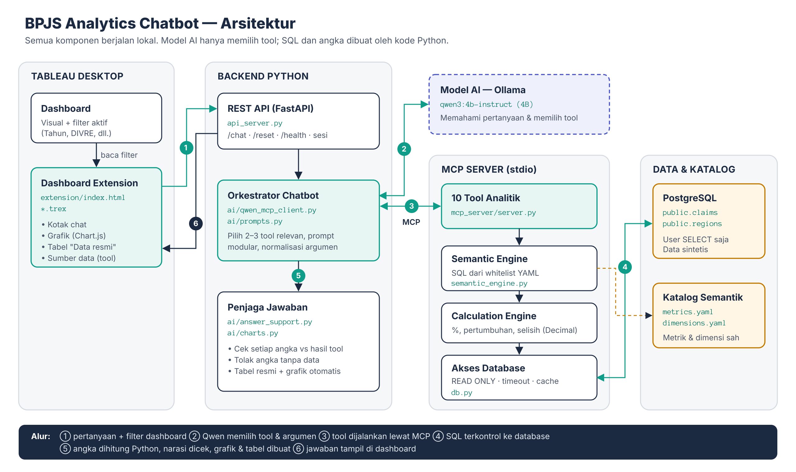

# BPJS Analytics Chatbot

Chatbot analitik data pelayanan BPJS yang terintegrasi dengan **Tableau**
(Dashboard Extension `.trex`), memakai **Qwen** (via Ollama) sebagai model AI
dan **MCP** (Model Context Protocol) sebagai jembatan aman ke **PostgreSQL**.

> **Catatan:** proyek pribadi, bukan produk resmi BPJS Kesehatan. Repo ini
> tidak berisi data asli. Nama tabel/kolom sudah disamarkan, dan data contoh
> dibuat acak oleh `scripts/generate_sample_data.py`.

## Arsitektur



Penjelasan tiap komponen, alur satu pertanyaan, dan prinsip desainnya ada di
[architecture.id.md](architecture.id.md).

Model AI **tidak pernah menulis SQL**. Qwen hanya memilih tool + metrik +
dimensi + filter; SQL dibentuk dari whitelist, dan semua angka turunan
dihitung oleh Python.

## Struktur folder

| Path | Isi |
|---|---|
| `main.py` | Chatbot versi terminal (CLI) |
| `api_server.py` | REST API untuk Tableau Extension |
| `ai/qwen_mcp_client.py` | Klien Qwen + MCP, normalisasi argumen, format jawaban |
| `mcp_server/` | MCP Server, Semantic Engine, Calculation Engine, akses DB |
| `config/metrics.yaml`, `config/dimensions.yaml` | Katalog metrik & dimensi |
| `extension/` | UI chatbot (`index.html`) dan manifest Tableau (`.trex`) |
| `tests/` | Pengujian (pytest) |
| `docs/` | Dokumentasi arsitektur, diagram, cakupan pertanyaan |
| `scripts/generate_sample_data.py` | Generator data sintetis (PostgreSQL) |
| `scripts/evaluate_questions.py` | Evaluasi pemilihan tool oleh Qwen |

## Instalasi

```bash
python -m venv .venv
source .venv/bin/activate          # Windows: .venv\Scripts\activate
pip install -r requirements.txt
cp .env.example .env               # lalu isi kredensial database
```

Siapkan Ollama + model Qwen:

```bash
ollama pull qwen3:4b-instruct
```

Siapkan database contoh (data sintetis, seluruhnya fiktif):

```bash
createdb claims_demo
python scripts/generate_sample_data.py --rows 50000 > sample_data.sql
psql -d claims_demo -f sample_data.sql
```

Skrip ini membuat tabel `public.claims` (satu baris = satu pelayanan) dan
`public.regions` (lookup DIVRE). Gunakan `--seed` agar data dapat diulang.
Di akhir `sample_data.sql` ada contoh perintah membuat user baca-saja.

## Menjalankan

**CLI (terminal):**

```bash
python main.py
```

Perintah: `reset` / `baru` untuk percakapan baru, `exit` / `keluar` untuk keluar.

**API untuk Tableau:**

```bash
python api_server.py
```

atau `uvicorn api_server:app --host 127.0.0.1 --port 8000`.

Endpoint:

| Method | Path | Fungsi |
|---|---|---|
| GET | `/health` | Status chatbot, database, model, daftar tool |
| POST | `/chat` | `{"question": "...", "session_id": "opsional", "tableau_context": {...}}` |
| POST | `/reset` | `{"session_id": "..."}` — hapus riwayat percakapan |
| GET | `/extension/index.html` | UI chatbot |

## Memasang di Tableau

1. Jalankan `python api_server.py` (harus di `http://localhost:8000`).
2. Di Tableau Desktop: **Dashboard → Objects → Extension → Access Local
   Extensions** → pilih `extension/bpjs_analytics_assistant.trex`.
3. Extension otomatis membaca **filter aktif dashboard** (mis. Tahun, DIVRE)
   dan mengirimnya sebagai konteks ke Qwen. Centang
   *"Sertakan filter dashboard"* untuk mengaktifkan/menonaktifkan.

Library Tableau Extensions dimuat dari `extension/lib/` bila ada, jika tidak
dari CDN resmi Tableau (lihat `extension/lib/README.md`).

## Tool MCP

| Tool | Fungsi |
|---|---|
| `inspect_data` | Katalog metrik & dimensi yang tersedia |
| `analyze_data` | Analisis agregat (metrik + dimensi + filter) |
| `compare_costs` | Biaya tagihan vs verifikasi, selisih & persentase |
| `service_mix` | Komposisi RJTL/RITL + persentase |
| `service_growth` | Pertumbuhan jumlah pelayanan antar-tahun |
| `metric_growth` | Pertumbuhan metrik apa pun antar-tahun |
| `metric_share` | Persentase metrik per kategori; `within` untuk persentase di dalam kelompok |
| `compare_metrics` | Beberapa metrik sekaligus per kategori + peringkat & tertinggi/terendah |
| `top_categories` | N kategori teratas/terbawah, opsional per kelompok (mis. diagnosis per RJTL/RITL) |
| `profile_summary` | Ringkasan karakteristik + temuan (insights) yang dihitung Python |

`analyze_data` juga menerima `order` (`desc`/`asc`) dan `sort_by`
(`metric`/`dimension`), dan `compare_costs` menerima `dimensions` untuk
rincian per DIVRE/segmen.

## Grafik otomatis

Setiap jawaban yang berisi data menampilkan grafik di bawah penjelasan
(tombol "Sembunyikan grafik" tersedia). Grafik dibuat Python dari data
resmi yang sama dengan tabel "Data resmi" (`ai/charts.py`), bukan oleh
Qwen, sehingga selalu konsisten dan tidak menambah beban model.

| Bentuk data | Grafik |
|---|---|
| 1 dimensi | Batang horizontal |
| Tahun/bulan | Garis (tren) |
| Persentase di dalam kelompok | Batang bertumpuk 100% |
| Peringkat per kelompok | Batang berkelompok (#1, #2, #3) |
| Beberapa metrik, satuan sama | Batang berkelompok |
| Beberapa metrik, satuan berbeda | Satu grafik per metrik (tanpa dua sumbu) |
| Pertumbuhan | Dua batang (tahun pembanding vs tahun terbaru) |

Pengaturan `.env`: `ANSWER_CHARTS=0` untuk mematikan, `CHART_MAX_CATEGORIES`
untuk batas kategori per grafik (default 20).

## Bank pertanyaan & evaluasi

Daftar pertanyaan uji ada di `tests/questions/question_bank.yaml`
(lihat ringkasannya di `docs/cakupan_pertanyaan.md`). Tambahkan pertanyaan
baru dengan format yang sama.

1. **Kemampuan sistem** (tanpa Qwen) — menjalankan panggilan tool acuan tiap
   pertanyaan ke database:

   ```bash
   pytest tests/test_question_bank.py
   ```

2. **Kemampuan Qwen memilih tool** — menjalankan pertanyaan lewat Qwen asli
   dan membuat laporan di `reports/`:

   ```bash
   python scripts/evaluate_questions.py
   python scripts/evaluate_questions.py --ids 1 5 25-30
   python scripts/evaluate_questions.py --category klinis
   ```

## Pengujian

```bash
pip install -r requirements-dev.txt
pytest
```

- Test tanpa database selalu berjalan.
- Test `db` berjalan otomatis bila PostgreSQL di `.env` dapat diakses.
- Test konsistensi data di database (`tests/test_semantic_execution.py`):
  `RUN_DATASET_TESTS=1 pytest`

## Konfigurasi (.env)

Lihat `.env.example`. Variabel wajib: `DB_HOST`, `DB_PORT`, `DB_NAME`,
`DB_USER`, `DB_PASSWORD`. Opsional: `OLLAMA_MODEL`, `OLLAMA_HOST`,
`OLLAMA_NUM_PREDICT`, `OLLAMA_NUM_CTX`, `MAX_HISTORY_TURNS`, `DB_STATEMENT_TIMEOUT`,
`API_HOST`, `API_PORT`, `CORS_ORIGINS`, `LOG_LEVEL`.

## Catatan keamanan

- Gunakan user database dengan hak **SELECT saja**.
- Kolom identitas (`member_id`, `claim_id`, dll.) diblokir sebagai dimensi.
- Detail error database tidak dikirim ke pengguna; dicatat di
  `logs/mcp_server.log`.
- API default hanya mendengarkan `127.0.0.1`. CORS nonaktif kecuali
  `CORS_ORIGINS` diisi.
