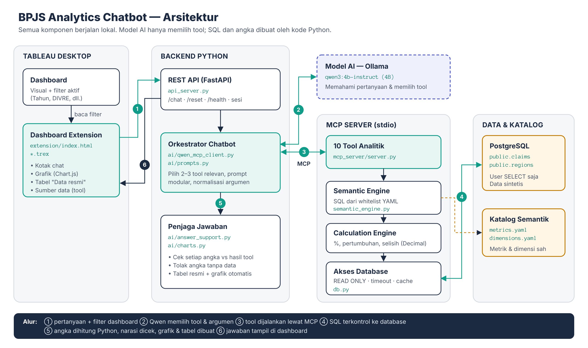
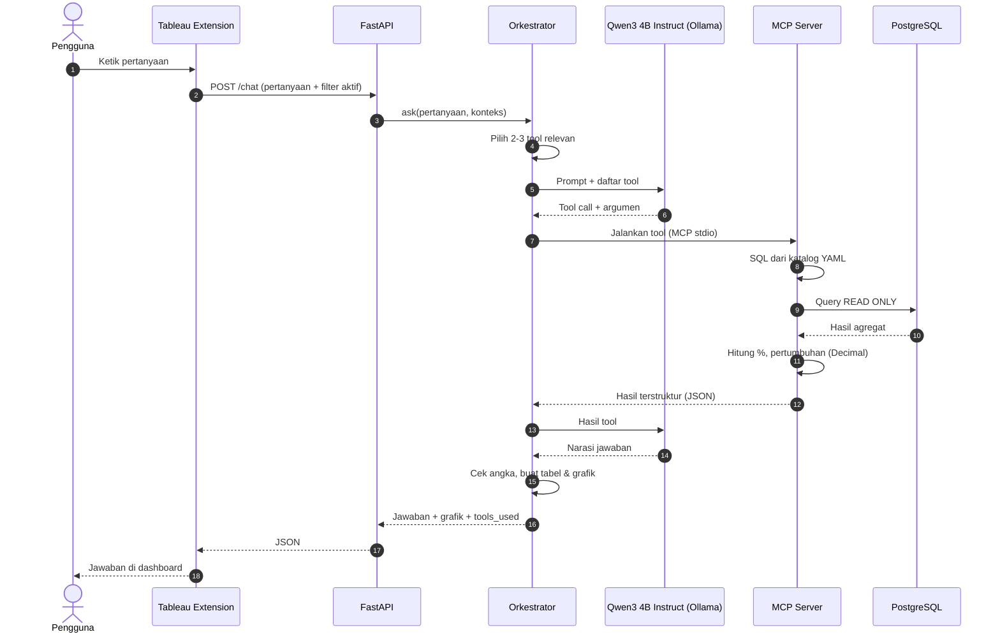

# Arsitektur

Dokumen ini menjelaskan bagaimana satu pertanyaan di dashboard Tableau
berubah menjadi jawaban yang angkanya terverifikasi: komponen apa saja yang
terlibat, siapa mengerjakan apa, dan mengapa desainnya dibuat begitu.



## Prinsip desain

1. **Model AI tidak menulis SQL.** Qwen hanya memilih *tool* beserta metrik,
   dimensi, dan filter. SQL dibentuk oleh Semantic Engine dari katalog YAML
   yang sudah di-whitelist, sehingga model tidak bisa membaca kolom atau
   tabel di luar katalog.
2. **Angka tidak dihitung oleh model.** Agregasi dihitung database;
   persentase, pertumbuhan, dan selisih dihitung Calculation Engine dengan
   `Decimal`. Model hanya menarasikan.
3. **Setiap angka di jawaban dicek ulang.** Angka di narasi dicocokkan dengan
   hasil tool. Jawaban berisi angka tanpa pemanggilan tool tidak ditampilkan.
4. **Ringan untuk laptop 8 GB.** Per pertanyaan hanya 2–3 tool relevan yang
   dikirim ke model, prompt disusun modular, dan hasil query di-cache.
5. **Aman secara default.** Transaksi READ ONLY, batas waktu query, kolom
   identitas diblokir, dan detail error database tidak dikirim ke pengguna.

## Komponen

| Lapisan | Komponen | File | Tanggung jawab |
|---|---|---|---|
| UI | Dashboard Extension | `extension/index.html`, `*.trex` | Kotak chat, membaca filter aktif dashboard, menampilkan jawaban, grafik (Chart.js), tabel "Data resmi", dan sumber data |
| API | REST API | `api_server.py` | Endpoint `/chat`, `/reset`, `/health`; sesi percakapan per pengguna |
| Orkestrasi | Chatbot client | `ai/qwen_mcp_client.py`, `ai/prompts.py` | Memilih tool relevan, menyusun prompt, memanggil Qwen, menormalkan argumen, memanggil tool lewat MCP |
| Orkestrasi | Penjaga jawaban | `ai/answer_support.py`, `ai/charts.py` | Memeriksa angka di narasi, membuat tabel data resmi dan grafik dari hasil tool |
| Model | Qwen3 4B Instruct (Ollama) | — | Memahami pertanyaan dan memilih tool + argumen |
| Tool | MCP Server | `mcp_server/server.py` | 10 tool analitik (`analyze_data`, `metric_share`, `compare_metrics`, dll.) |
| Tool | Semantic Engine | `mcp_server/semantic_engine.py` | Membentuk SQL berparameter dari katalog; validasi metrik, dimensi, filter |
| Tool | Calculation Engine | `mcp_server/calculation_engine.py` | Persentase, pertumbuhan, selisih, peringkat dengan `Decimal` |
| Tool | Akses database | `mcp_server/db.py` | Koneksi PostgreSQL, READ ONLY, timeout, cache hasil query |
| Data | Katalog semantik | `config/metrics.yaml`, `config/dimensions.yaml` | Daftar metrik dan dimensi yang sah beserta ekspresi SQL-nya |
| Data | Database | PostgreSQL (`public.claims`, `public.regions`) | Data pelayanan; di repo ini data sintetis |

## Alur satu pertanyaan



## Struktur repo

```
.
├── api_server.py            # REST API untuk Tableau Extension
├── main.py                  # Versi CLI (terminal)
├── ai/                      # Orkestrator, prompt, penjaga jawaban, grafik
├── mcp_server/              # MCP Server, Semantic & Calculation Engine, akses DB
├── config/                  # Katalog metrik & dimensi (YAML)
├── extension/               # UI chatbot + manifest Tableau (.trex)
├── scripts/
│   ├── generate_sample_data.py   # Data sintetis untuk mencoba
│   └── evaluate_questions.py     # Evaluasi pemilihan tool oleh Qwen
├── tests/                   # Pytest + bank pertanyaan
└── docs/                    # Dokumentasi & diagram
```
