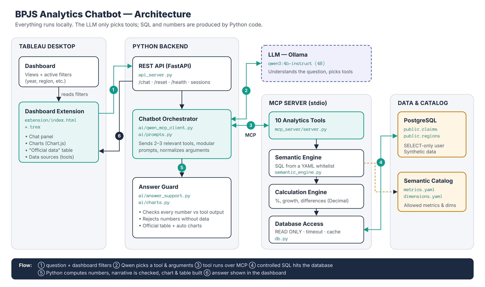
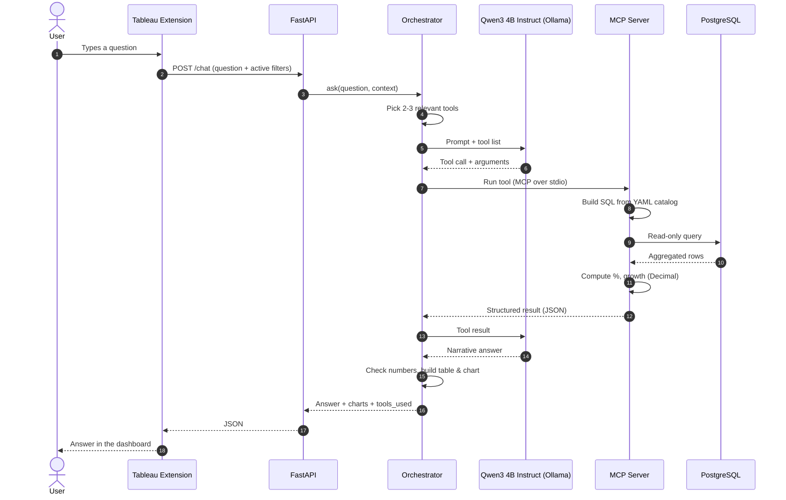

# Architecture

This document explains how one question typed in a Tableau dashboard becomes
an answer whose numbers have been verified. It covers which components are
involved, what each one is responsible for, and why the system is designed
this way. (Indonesian version: [architecture.id.md](architecture.id.md).)



## Design principles

1. **The LLM never writes SQL.** Qwen only chooses a *tool* and fills in a
   metric, dimensions, and filters. SQL is assembled by the Semantic Engine
   from a whitelisted YAML catalog, so the model cannot reach any table or
   column outside that catalog.
2. **The LLM never calculates.** Aggregations run in the database.
   Percentages, growth, and differences are computed by the Calculation
   Engine with `Decimal`. The model only writes the narrative.
3. **Every number in the answer is checked.** Numbers in the narrative are
   matched against the tool output. An answer that contains data figures
   but called no tool is never shown.
4. **Light enough for an 8 GB laptop.** Only the 2–3 tools relevant to the
   question are sent to the model, the prompt is modular, and query results
   are cached.
5. **Safe by default.** Read-only transactions, a per-query timeout, blocked
   identity columns, and database error details are never returned to users.

## Components

| Layer | Component | Files | Responsibility |
|---|---|---|---|
| UI | Dashboard Extension | `extension/index.html`, `*.trex` | Chat panel; reads the dashboard's active filters; renders the answer, charts (Chart.js), the "official data" table, and data sources |
| API | REST API | `api_server.py` | `/chat`, `/reset`, `/health` endpoints; one conversation per session |
| Orchestration | Chatbot client | `ai/qwen_mcp_client.py`, `ai/prompts.py` | Selects relevant tools, builds the prompt, calls Qwen, normalizes arguments, calls tools over MCP |
| Orchestration | Answer guard | `ai/answer_support.py`, `ai/charts.py` | Checks numbers in the narrative; builds the official data table and charts from tool output |
| Model | Qwen3 4B Instruct (Ollama) | — | Understands the question and chooses a tool and its arguments |
| Tools | MCP server | `mcp_server/server.py` | 10 analytics tools (`analyze_data`, `metric_share`, `compare_metrics`, …) |
| Tools | Semantic Engine | `mcp_server/semantic_engine.py` | Builds parameterized SQL from the catalog; validates metrics, dimensions, and filters |
| Tools | Calculation Engine | `mcp_server/calculation_engine.py` | Percentages, growth, differences, and ranks using `Decimal` |
| Tools | Database access | `mcp_server/db.py` | PostgreSQL connection; SQL validation with `sqlglot`; read-only transaction, timeout, result cache |
| Data | Semantic catalog | `config/metrics.yaml`, `config/dimensions.yaml` | The allowed metrics and dimensions and how each maps to SQL |
| Data | Database | PostgreSQL (`public.claims`, `public.regions`) | Service records; synthetic in this repository |

## Two layers of whitelisting

A metric must pass two checks before it can reach the database:

1. It must exist in `config/metrics.yaml` with `status: validated`.
2. Its SQL expression must also exist in `ALLOWED_METRICS` inside
   `mcp_server/semantic_engine.py`. The SQL that runs comes from this
   dictionary in code, not from the YAML file.

Dimensions work the same way. Column names are quoted as identifiers,
lookup tables must be listed in `ALLOWED_LOOKUP_TABLES`, and identity
columns listed in `SENSITIVE_COLUMNS` can never be used as dimensions.
Filter values are always passed as query parameters, never pasted into SQL.
As a final check, `db.py` parses the SQL with `sqlglot` and refuses anything
other than a single `SELECT`.

## Lifecycle of one question



## Repository layout

```
.
├── api_server.py            # REST API for the Tableau extension
├── main.py                  # Terminal (CLI) chatbot
├── ai/                      # Orchestrator, prompts, answer guard, charts
├── mcp_server/              # MCP server, Semantic & Calculation engines, DB access
├── config/                  # Metric & dimension catalog (YAML)
├── extension/               # Chat UI + Tableau manifest (.trex)
├── scripts/
│   ├── generate_sample_data.py   # Synthetic data for trying it out
│   └── evaluate_questions.py     # Evaluates Qwen's tool selection
├── tests/                   # pytest suite + question bank
└── docs/                    # Documentation & diagrams
```
